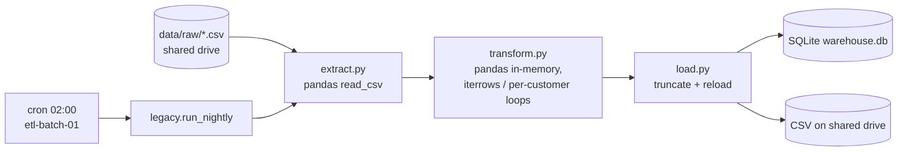
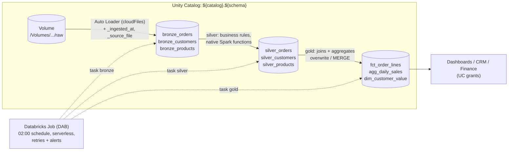

# Migration: legacy pandas/SQLite batch → Databricks Lakehouse

This document covers the move of the nightly retail ETL from `legacy/` (pandas + SQLite, cron on
`etl-batch-01.corp.local`) to `databricks_pipeline/` (PySpark + Delta Lake + Unity Catalog,
deployed as a Databricks Asset Bundle). `legacy/` is unchanged so both can run in parallel
during cut-over.

## Architecture

### Before



Single box, single process, no history, no lineage, no retries, no access control.

### After



| Layer | Module | Tables | Write semantics |
|---|---|---|---|
| bronze | `databricks_pipeline/bronze.py` | `bronze_orders`, `bronze_customers`, `bronze_products` | Auto Loader append, exactly-once via checkpoint (`availableNow` trigger). Local/batch mode: overwrite. |
| silver | `databricks_pipeline/silver.py` | `silver_orders`, `silver_customers`, `silver_products` | Full rebuild from bronze, atomic overwrite. |
| gold | `databricks_pipeline/gold.py` | `fct_order_lines`, `agg_daily_sales`, `dim_customer_value` | Fact and aggregate: atomic overwrite. Customer dim: `MERGE` on `customer_id` (update changed rows, insert new, delete vanished). |

Every write is idempotent: rerunning any task on the same input leaves the tables with the same contents
(`tests/test_parity.py::test_rerun_is_idempotent`). A rerun of `dim_customer_value` commits a MERGE that
touches no rows.

Bronze keeps every column as a string, exactly as delivered, plus `_ingested_at` (ingest timestamp) and
`_source_file` (from `_metadata.file_path`). On Databricks, Auto Loader also adds `_rescued_data` for any
values that do not fit the expected columns. Files are matched per source with `pathGlobFilter`
(`orders*.csv`, `customers*.csv`, `products*.csv`), so `orders_20250101.csv`-style drops work.

## Legacy rule → Spark mapping

| # | Legacy rule (`legacy/transform.py`) | Spark implementation | Test |
|---|---|---|---|
| 1 | `drop_duplicates()` on the raw string frame (double-delivered files) | `silver.clean_orders`: `dropDuplicates(raw_cols)` on the raw string columns, before any parsing | `test_exact_duplicates_dropped_but_near_duplicates_kept` |
| 2 | `_parse_date`: `%Y-%m-%d` or `%m/%d/%Y`, after `strip()` | `silver.parse_date`: regex match for each format, then `make_date` after a calendar check (`last_day`). Same leniency as `strptime` (1–2 digit month/day, 4-digit year) and does not depend on `timeParserPolicy` or ANSI mode | `test_parse_date_matches_legacy` (18 cases checked against `_parse_date`) |
| 3 | Rows with unparseable dates dropped | `.where(order_date IS NOT NULL)` | `test_bad_dates_dropped` |
| 4 | `astype(int/float)` casts | `.cast("bigint"/"int"/"double")` | `test_types` |
| 5 | Blank `discount_pct` = 0 | `coalesce(blank_to_null(discount_pct).cast("double"), 0.0)` | `test_blank_discount_is_zero` |
| 6 | `channel.str.strip().str.lower()` | `lower(strip(channel))` where `strip` trims all whitespace like Python | `test_channel_normalised` |
| 7 | `gross = round(qty * unit_price, 2)`, `net = round(gross * (1 - discount), 2)` | `round_half_even_2dp(x) = rint(x * 100) / 100`, the same float64 operations numpy's `round` uses, so results are bit-identical (Spark's `round` is HALF_UP and would not be) | `test_money_rounding_is_bit_identical_to_pandas` (3,000 random lines) |
| 8 | Returns: `is_return = quantity < 0`, kept in revenue | `is_return = quantity < 0`; negative quantity nets revenue down | `test_returns_flagged_and_net_down_revenue` |
| 9 | Region: `strip().upper()`, blank → `UNKNOWN` | `upper(strip(region))`, NULL/blank → `'UNKNOWN'` | `test_region_normalised_and_blank_is_unknown` |
| 10 | Blank email → NULL | `blank_to_null(email)` | same |
| 11 | Inner join to customers (drops orphans, DATA-212); left join to products | `gold.build_order_facts`: `join(..., "inner")` then `join(..., "left")` | `test_inner_join_drops_orphan_customers_and_left_join_products` |
| 12 | `cost = round(qty * unit_cost, 2)`, `margin = round(net - cost, 2)` | same with `round_half_even_2dp`, stored as `DECIMAL(18,2)` | same |
| 13 | `agg_daily_sales`: groupby date × region × category; `nunique(order_id)`, `sum` | `groupBy(...).agg(countDistinct, sum)`. NULL group keys are filtered, matching pandas `groupby(dropna=True)` | parity test |
| 14 | `customer_lifetime_value`: Python loop per customer; VIP / MID / STANDARD from `config.HIGH/MID_VALUE_THRESHOLD` | one `groupBy("customer_id")` + `when/otherwise`; thresholds from `PipelineConfig.vip_threshold` / `mid_threshold` (CLI flag, `RETAIL_*` env var or bundle variable) | `test_tier_thresholds_come_from_config`, parity test |

There are no Python UDFs, no `toPandas()` and no row loops in `databricks_pipeline/`.

### Intentional differences

- **Money columns are `DECIMAL(18,2)`** in gold (`gross_amount`, `net_amount`, `cost_amount`,
  `margin_amount`, `net_revenue`, `margin`, `lifetime_net_revenue`) instead of float64. Line amounts are
  still rounded exactly like legacy and then stored as decimals, so the aggregates are exact sums.
  Parity: 0.00 difference on every money column.
- **Full history from incremental drops (confirmed: upstream sends only new data each night).**
  Legacy truncates and reloads from whatever is in `data/raw/` that night, so its outputs only ever
  covered the latest drop. The Lakehouse appends every drop to bronze (Auto Loader ingests each file
  once) and rebuilds silver/gold from all of it, with exact duplicates removed across drops. As a result:
  - `fct_order_lines` and `agg_daily_sales` cover every order received so far, not just last night's.
  - `dim_customer_value` is a true lifetime value: `lifetime_net_revenue`, `order_count`,
    first/last order date and `tier` accumulate across nights, so tiers can differ from what the legacy
    job reported once several nights have landed.
  - Orders whose customer arrived in an earlier night's `customers` drop are kept. Legacy would have
    dropped them as orphans (DATA-212 inner join) because it only saw that night's customer file.
  - Covered by `tests/test_parity.py::test_incremental_drops_accumulate_full_history`: the raw data is
    split into two nightly drops, and after night 2 gold matches the golden snapshots exactly.
- **Latest row wins for customers/products.** `silver.latest_per_key` keeps the most recently
  ingested row per `customer_id` / `product_id`, so a customer or product re-sent in a later drop
  (e.g. a region change) updates the dimension instead of duplicating join rows.

## Parity results (local Spark 3.5.3 + Delta 3.2.1, `data/raw/`)

`pytest tests/test_parity.py`:

| Table | Rows (expected / actual) | Non-money columns | Max abs diff on money columns |
|---|---|---|---|
| `agg_daily_sales` | 9,613 / 9,613 | exact match | 0.00 (`net_revenue`, `margin`) |
| `dim_customer_value` | 800 / 800 | exact match (incl. `tier`) | 0.00 (`lifetime_net_revenue`) |
| `fct_order_lines` (vs. a live legacy run) | 29,424 / 29,424 | exact match | 0.00 |

The tests allow a tolerance of 0.01 on money columns.

## Deploy

Prerequisites: a recent Databricks CLI (config checked with v1.24), a Unity Catalog-enabled
workspace with serverless jobs, and:

```sql
CREATE SCHEMA IF NOT EXISTS main.retail_dev;                 -- prod: main.retail
CREATE VOLUME IF NOT EXISTS main.retail_dev.raw;             -- landing zone for the CSV drops
CREATE VOLUME IF NOT EXISTS main.retail_dev._checkpoints;    -- Auto Loader state
```

Point the POS / e-commerce drops (currently the shared drive) at the `raw` Volume, then:

```bash
pip install build                         # the bundle builds the wheel with `python -m build`
databricks auth login --host https://<workspace>.cloud.databricks.com
databricks bundle validate -t dev
databricks bundle deploy   -t dev         # builds + uploads the wheel, creates "[dev <you>] retail-nightly-etl"
databricks bundle run      -t dev retail_nightly_etl
```

Production:

```bash
databricks bundle deploy -t prod --var alert_email=oncall@yourco.com
```

All Unity Catalog names, paths, thresholds, the schedule time zone and the alert address are bundle
variables (`databricks.yml`) and can be overridden per target or with `--var`. `dev` uses
`main.retail_dev` and development mode (schedule paused, resources prefixed with the user name);
`prod` uses `main.retail` and runs unpaused at 02:00.

Local run (no workspace needed):

```bash
pip install -r requirements.txt           # needs Java 11 or 17
python -m databricks_pipeline.main all --local --catalog spark_catalog --schema retail \
    --ingest-mode batch --source-path data/raw
```

### Cut-over plan

1. Deploy `dev`, land a copy of the nightly drop into the dev Volume, run the job and compare gold to
   the legacy SQLite outputs (the parity test logic in `tests/test_parity.py` can be pointed at both).
   Only the **first** night is directly comparable: from night 2 on, gold covers all drops while legacy
   only covers the latest one (see *Full history from incremental drops*).
2. Deploy `prod` and let it run in parallel with the cron job for a few nights. Compare outputs daily
   for that night's `order_date`s and customers only.
3. Move consumers (exec dashboard, CRM, finance) from the shared-drive CSVs to the UC tables.
4. Disable the cron entry on `etl-batch-01` (`legacy/crontab.txt`), then remove `legacy/` in a later PR.

## What changes operationally

| Concern | Legacy | Lakehouse |
|---|---|---|
| Scheduling | cron on one server | Databricks Job `retail-nightly-etl`, Quartz `0 0 2 * * ?` in UTC, `max_concurrent_runs: 1` |
| Compute | one VM, in-memory pandas (OOMs on peak volume) | serverless jobs compute that scales with the data. A small job cluster is an option (see comment in `resources/retail_nightly_etl.job.yml`) |
| Failure handling | log file, manual rerun | each task retries twice (5 min apart, also on timeout). Failed runs can be repaired from the failed task. Email on failure and when a run exceeds 1 h (`health` rule); 3 h hard timeout |
| History | truncate + reload, none | **Delta time travel**: `SELECT * FROM main.retail.agg_daily_sales VERSION AS OF 12` / `TIMESTAMP AS OF '2025-01-01'`, `DESCRIBE HISTORY`, `RESTORE TABLE ... TO VERSION AS OF n` to roll back a bad load |
| Lineage | none | **Unity Catalog lineage** is captured automatically from Volume → bronze → silver → gold → dashboards (Catalog Explorer → Lineage tab, or `system.access.table_lineage`) |
| Access control | anyone with the shared drive | **UC grants**, e.g. below. Audit via `system.access.audit` |
| Incremental ingest | re-read everything | Auto Loader tracks processed files in the checkpoint; a file is ingested once even if the job is rerun |
| Deploys | copy files to the server | `databricks bundle deploy` from CI, versioned in git, separate dev/prod targets |

Example grants:

```sql
GRANT USE CATALOG ON CATALOG main TO `retail-analysts`;
GRANT USE SCHEMA, SELECT ON SCHEMA main.retail TO `retail-analysts`;      -- read gold
GRANT SELECT ON TABLE main.retail.dim_customer_value TO `crm-marketing`;
GRANT READ VOLUME, WRITE VOLUME ON VOLUME main.retail.raw TO `pos-ecom-drop-sp`;
```

Consider granting analysts SELECT on the gold tables only (or put gold in its own schema) so bronze/silver
stay internal. Time travel depends on retention (`delta.logRetentionDuration`, default 30 days;
`VACUUM` default 7 days).

## Not verified without a live workspace

- `databricks bundle deploy` / `run` against a real workspace. `bundle validate` was run with CLI v1.24
  up to the authentication step, and the merged config validates against `databricks bundle schema`.
- The Auto Loader (`cloudFiles`) path in `bronze.ingest_autoloader`. Locally the same reader options and
  metadata columns are exercised through `spark.read.csv`.
- Serverless specifics: `environment_version: "2"`, wheel installation from `../dist/*.whl`, and the
  `python_wheel_task` entry point `retail_pipeline`.
